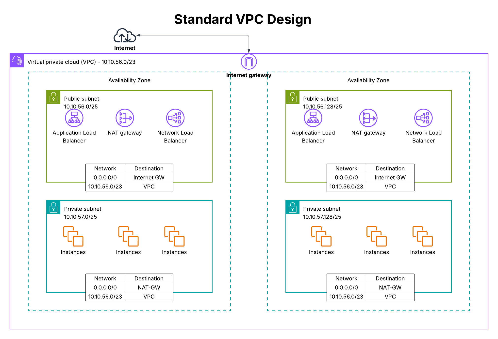
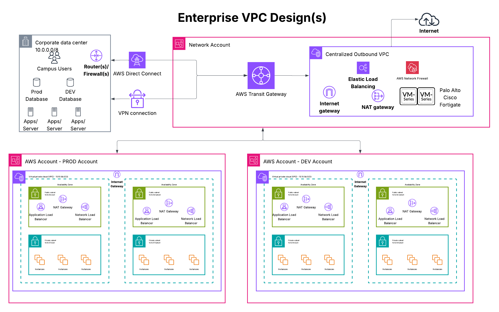

# VPC Design

## Learning goals

Explain CIDR planning, public/private subnets, route-table associations, and outbound internet access.

## Core concepts

- Choose non-overlapping CIDRs so future VPC and hybrid connectivity remains possible.
- A public subnet has a direct route to an internet gateway. Direct IPv4 internet connectivity also requires an appropriate public address and security rules.
- A private subnet has no direct IGW route. For this lesson, outbound internet traffic uses a public NAT gateway in a public subnet.
- Each subnet uses one effective route table. Check associations rather than relying on names.
- Route tables select paths; security groups and NACLs control permitted traffic.
- Use multiple AZs for production availability. The single-AZ assignment deliberately keeps the learning environment small.

## Classroom exercise

Trace the request and response from a private EC2 instance to an internet HTTPS endpoint. Explain the role of the local route, default route, NAT gateway, and IGW.

## High Level Diagrams

## Hands-on assignment

Follow [Build a Public and Private VPC Lab](../assignments/README.md) to create two subnets, a NAT gateway, and two EC2 instances. Capture connectivity evidence and complete cleanup.

## References

- [VPC documentation](https://docs.aws.amazon.com/vpc/latest/userguide/what-is-amazon-vpc.html)
- [NAT gateways](https://docs.aws.amazon.com/vpc/latest/userguide/vpc-nat-gateway.html)

[Back to Week 2](../../README.md)
